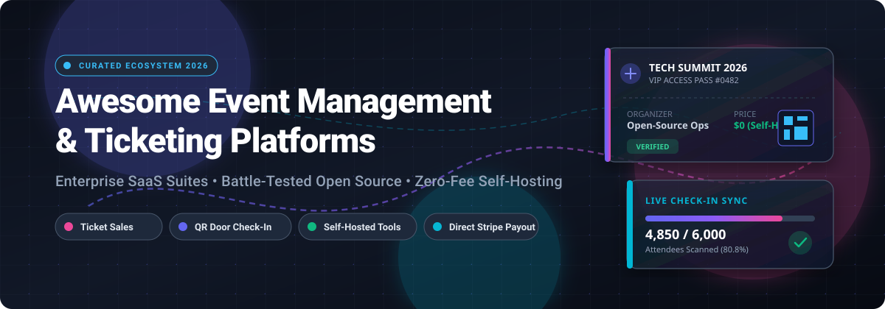

  

# 🎟️ Awesome Event Management & Ticketing Ecosystem 🎪

  <strong>🌟 A curated directory of category-defining SaaS event suites &amp; battle-tested open-source ticketing platforms, conference apps, registration systems, and door check-in tools. 🚀</strong>

  <a href="#-sector-overview--market-dynamics">Sector Overview</a> •
  <a href="#-commercial-saas-platforms">SaaS Platforms</a> •
  <a href="#-open-source--self-hosted-solutions">Open-Source Engines</a> •
  <a href="#-key-architectural-considerations">Architecture</a> •
  <a href="#-star-history">Star History</a> •
  <a href="#-support--sponsor">Support</a>

---

Event management and ticketing platforms power modern experiences—from international enterprise conferences and university summits to concerts, trade shows, hackathons, and local community meetups. This guide catalogs commercial SaaS solutions alongside powerful open-source, self-hosted alternatives with zero per-ticket platform fees.

---

## 📑 Table of Contents

- [📊 Sector Overview & Market Dynamics](#-sector-overview--market-dynamics)
- [💼 Commercial SaaS Platforms](#-commercial-saas-platforms)
- [💻 Open-Source & Self-Hosted Solutions](#-open-source--self-hosted-solutions)
- [🏗️ Key Architectural Considerations](#-key-architectural-considerations)
- [📈 Star History](#-star-history)
- [🤝 How to Contribute](#-how-to-contribute)
- [💖 Support & Sponsor](#-support--sponsor)
- [⚖️ License & Disclaimer](#️-license--disclaimer)

---

## 📊 Sector Overview & Market Dynamics

The global Event Management Software (EMS) and ticketing market is estimated at **$11B to $18B** and is projected to expand toward **$24B to $36B+ by the 2030s**, compounding at an estimated **CAGR of 9.7% to 14.6%**. 

The sector structure is **moderately concentrated at the enterprise peak but highly fragmented across the mid and lower tiers**:
- 🏢 **Enterprise Consolidation:** Private equity and industry giants (such as Blackstone / Cvent and Bending Spoons / Eventbrite) aggressively acquire point solutions (e.g., Cvent's acquisition of Splash, Goldcast, and ON24) to construct comprehensive, end-to-end event experience operating systems.
- 🌐 **Mid-Market & Open-Source Dispersion:** The long-tail market remains decentralized across niche registration portals, community meetup tools, and white-label agencies. Increasingly, developers and event organizers seek data sovereignty, custom payment workflows via direct Stripe Connect, and freedom from high per-ticket platform commissions through self-hosted open-source software.

---

## 💼 Commercial SaaS Platforms

The table below benchmarks major commercial event management and ticketing platforms, sorted in descending order by scale (valuation or annual revenue).

| Company / Product | Scale (Valuation / Revenue) | Description & Key Strengths | Pricing (Starting Tier) | Free Tier / Free Trial Limits |
|---|---|---|---|---|
| **[Cvent](https://www.cvent.com/)** | **~$4.6B Valuation** (~$650M+ ARR; acquired by Blackstone) | Enterprise event management and hospitality cloud covering global registration, venue sourcing, onsite check-in, lead retrieval, and event marketing. | **Pay-as-you-go** registration model available; annual enterprise license packages start at **~$10,000/year** (custom quote-based) | **No permanent free tier**; free sandbox account to build event registration workflows before publishing; guided 1:1 sales demo |
| **[Eventbrite](https://www.eventbrite.com/)** | **~$500M Valuation** (~$325M ARR; acquired by Bending Spoons) | Global consumer marketplace and event discovery network featuring built-in organic reach, ticket scanning, and attendee messaging. | **Free for free tickets**; paid ticketing starts at **3.7% + $1.79 per sold ticket** + payment processing; marketing Pro tiers start at **$15/month** | **Free forever** with unlimited events for free-ticketed gatherings (no platform fee); paid events require per-ticket fees |
| **[Bizzabo](https://www.bizzabo.com/)** | **~$200M Valuation** (~$30M ARR) | All-in-one Event Experience Operating System (OS) combining registration, badge printing, networking, sponsor management, and B2B conference analytics. | Starts at **$17,999/year** (billed annually; minimum 3-user seat baseline) | **No free tier**; custom 1:1 enterprise demo required to test platform capabilities |
| **[Airmeet](https://www.airmeet.com/)** | **~$100M–$150M Valuation** (~$50M raised; ~$10M–$25M ARR) | Virtual, hybrid, and interactive webinar platform known for virtual attendee networking tables ("Social Lounge") and fluid stage management. | Starts at **$167/month** (Premium Webinars tier, billed annually) | **Free forever plan** capped at **50 live attendees per event**, up to **5 events per month**, 90-minute session duration limit, and 1 host seat |
| **[vFairs](https://www.vfairs.com/)** | **~$30M ARR** (Profitable, self-funded/bootstrapped) | Virtual conference and 3D exhibition hall platform with hybrid mobile apps, onsite badge printing kiosks, and dedicated white-glove event support. | Custom quote-based; single-event licenses start at **~$10,000/event**; multi-event packages start at **~$22,500/year** | **No permanent free tier**; provides immediate self-guided interactive sandboxes and guided product walkthroughs |
| **[Whova](https://whova.com/)** | **~$15M–$37M ARR** (Profitable, lightly funded) | Award-winning mobile conference application, attendee engagement app, paperless agenda manager, community board, and fast check-in kiosk suite. | Quote-based per-event model; ticketing platform fee starts at **3.0% + $0.99 per paid ticket** (plus payment processing) | **Free forever** for zero-cost / 100% free community events (zero ticketing fees); live product demo unlocks guided organizer trial |
| **[Accelevents](https://www.accelevents.com/)** | **Mid-Market SaaS** (Estimated ~$10M ARR) | Enterprise-grade all-in-one virtual, in-person, and hybrid event software with built-in badges, lead capture, and fundraising auction tools. | Professional tier starts at **$7,000/event**; annual Business licenses start at **$12,000/year** | **No permanent free live-event tier**; free account allows full administrative dashboard and event-builder testing without upfront payment |
| **[Splash](https://splashthat.com/)** | **Enterprise Division** (Acquired by Cvent; ~$40M raised prior) | Design-forward event marketing automation platform focused on branded landing pages, RSVP capture, VIP workflows, and CRM attribution. | Enterprise/Pro packages start at **~$6,700 to $7,500/year** (quote-based annual contracts) | **No free tier** (permanent free plan discontinued); trial access available upon qualified sales demo |
| **[Hopin](https://hopin.com/)** | **Assets acquired** (Virtual events business acquired by RingCentral) | Pioneer of multi-track virtual conferencing and digital expo booths; core event assets operate within the RingCentral Events suite. | Starts at **$750/year** (RingCentral Events starter tier for up to 100 attendees) | **Free trial available (14 days)** with test registration limits for staging digital stages |

---

## 💻 Open-Source & Self-Hosted Solutions

Open-source event software gives organizations complete ownership of attendee data (GDPR/privacy compliance), zero platform cuts on ticket sales, direct payout routing into custom merchant accounts (Stripe, PayPal, Mollie), and infinite customization.

The table below is sorted in descending order by GitHub stargazer count. Each social badge links directly to that repository's stargazers page.

| Project & Repo Link | Star Count | Architecture & Stack | Key Features & Focus |
|---|---|---|---|
| **[Attendize](https://github.com/Attendize/Attendize)** |  | PHP / Laravel + MySQL | Mature self-hosted ticket sales and door management engine. Features custom responsive event pages, multiple ticket classes, QR-code ticket generation, integrated web-based barcode scanner for check-in staff, affiliate tracking links, and direct Stripe/PayPal gateway integration. |
| **[Hi.Events](https://github.com/HiEventsDev/Hi.Events)** |  | PHP / Laravel + React + PostgreSQL + Docker | Modern alternative to Eventbrite and Ticket Tailor. Multi-tenant architecture designed for agencies and organizations. Features phone-camera QR check-in, tiered pricing, donation ticketing, capacity waitlists, tax/invoice generation, direct Stripe Connect (zero platform fees), and full REST APIs/webhooks. |
| **[fossasia / open-event-server](https://github.com/fossasia/open-event-server)** |  | Python / Flask + PostgreSQL + SQLAlchemy | The RESTful backend engine powering the comprehensive Eventyay platform. Provides comprehensive event management, micro-service role permissions, ticket ordering, call-for-speakers, scheduling, and billing APIs with OpenAPI specifications. |
| **[Pretix](https://github.com/pretix/pretix)** |  | Python / Django + PostgreSQL + Redis | Industry gold-standard ticketing platform engineered by rami.io. Free Community Edition supports unlimited tickets and orders. ISO 27001 certified security baseline, seat-map selection, complex voucher/discount rules, multilingual invoicing, extensive plugin ecosystem, and dedicated onsite kiosk hardware support. |
| **[Indico](https://github.com/indico/indico)** |  | Python / Flask + PostgreSQL + React | Originated at CERN for academic conferences and complex summit workflows. Features full paper/abstract submission, peer review, timetable drag-and-drop scheduling, badge layout design, registration, and room reservation capabilities. |
| **[freeCodeCamp / Chapter](https://github.com/freeCodeCamp/chapter)** |  | TypeScript / Node.js + Next.js + PostgreSQL | Self-hosted community meetup platform built by freeCodeCamp as an open-source alternative to Meetup.com. Tailored for nonprofit chapters, developer groups, and local clubs organizing recurring gatherings. |
| **[Eventyay](https://github.com/fossasia/eventyay)** |  | Python / Flask + Ember.js / Next.js | FOSSASIA's unified event platform covering ticketing, check-ins, multi-track talks and schedules, video stream integration, badge creation, and exhibition booth management for tech conferences. |
| **[alf.io](https://github.com/alfio-event/alf.io)** |  | Java (Spring Boot) + PostgreSQL / MySQL | Enterprise-grade ticket reservation system for conferences and meetups. Focuses on fair waiting lists, reservation grace periods, dynamic pricing rules, VAT compliance, offline attendee data encryption, and dedicated Android/iOS check-in scanning apps. |
| **[OSEM (Open Source Event Manager)](https://github.com/openSUSE/osem)** |  | Ruby on Rails + PostgreSQL / MySQL | Event management application tailored specifically for free and open-source software conferences. Manages call for papers (CFP), speaker scheduling, venue track logistics, sponsor packages, and participant registration. |
| **[Eventmie](https://github.com/classiebit/eventmie)** |  | PHP / Laravel + Vue.js + MySQL | Turnkey multi-vendor event ticketing platform package. Allows organizers to deploy their own branded Eventbrite alternative on standard shared or dedicated hosting with multi-currency support, seat bookings, and Stripe integration. |
| **[Event Espresso 4 Core](https://github.com/eventespresso/event-espresso-core)** |  | PHP / WordPress Plugin | Open-source core of WordPress's premier event registration and ticketing suite. Turns any WordPress installation into a full-fledged ticket sales hub with payment gateways, attendee registration forms, and calendar views. |
| **[eventschedule](https://github.com/eventschedule/eventschedule)** |  | TypeScript / Next.js + PostgreSQL | Lightweight, modern community event calendar and ticket reservation application designed for quick self-hosting, calendar subscription synchronization (iCal), and event discovery. |
| **[LibreEvent](https://github.com/janishutz/libreevent)** |  | JavaScript / Node.js + SQLite / MySQL | Minimalist, zero-friction self-hosted ticketing tool runnable on any standard hardware with Node.js 16+. Designed for small gatherings, community halls, and indie clubs looking for simple registration. |

---

## 🏗️ Key Architectural Considerations

When selecting or self-hosting an event management and ticketing engine, keep the following evaluation criteria in mind:

1. 💳 **Transaction Fees & Direct Payment Gateways**: Commercial aggregators often collect between 3% to 10% on ticket fees. Open-source platforms like **Pretix**, **Hi.Events**, and **Attendize** connect directly to your Stripe Connect or PayPal merchant accounts, eliminating third-party cuts outside of baseline payment interchange rates.
2. 🔒 **Attendee Privacy & GDPR Compliance**: Ticketing data includes attendee names, corporate affiliations, dietary restrictions, and credit card receipts. Self-hosting behind your own domain guarantees complete data sovereignty and simplifies regulatory compliance.
3. ⚡ **High-Concurrency Ticket Drops**: On-sale spikes can overwhelm simple web applications. Platforms like **Pretix** (built with Celery/Redis queues) and **alf.io** implement queued reservation hold timers to prevent overselling inventory during peak surges.
4. 📱 **Onsite Door Operations**: Ensure your platform provides reliable offline-capable check-in tools (such as native iOS/Android camera scanners or web-based barcode readers) to prevent gate bottlenecks when venue cellular connectivity degrades.

---

## 📈 Star History

---

## 🤝 How to Contribute

We welcome additions, updates, and corrections from event creators, developers, and maintainers!

1. 🍴 **Fork** this repository.
2. 🌿 Create a new branch: `git checkout -b feature/add-new-platform`.
3. 📝 Add or update the platform in the appropriate table in `README.md`.
   - Maintain the specified table columns and descending sorting rules.
   - For SaaS tools, provide verifiable starting pricing tiers and exact free tier/trial boundaries.
   - For open-source tools, include the proper GitHub star badge link: ``.
4. 💾 Commit your changes: `git commit -m "Add <Platform Name> to Awesome Event Management"`.
5. 🚀 Push to your branch and open a Pull Request.

---

## 💖 Support & Sponsor

Thank you for exploring and using this curated ecosystem! If you find this resource valuable, here are a few great ways you can support the project:

- ⭐ **Star this repository** to help others discover it across GitHub.
- 🍴 **Fork and contribute** by adding new tools, updating pricing tiers, or refining descriptions.
- 📢 **Share it** with event organizers, conference teams, and software engineers in your network.
- ☕ **Buy me a coffee / sponsor ongoing maintenance**: Support development directly via the [GitHub Sponsor Dashboard](https://github.com/sponsors/ishandutta2007).

Your support keeps this directory fresh, accurate, and actively maintained!

---

## ⚖️ License & Disclaimer

- 📄 **Content License**: Available under [Creative Commons Zero v1.0 Universal (CC0 1.0)](https://creativecommons.org/publicdomain/zero/1.0/).
- ⚠️ **Disclaimer**: Product names, logos, and brands cited are property of their respective owners. Listing in this repository does not constitute an endorsement. Verify all vendor terms, pricing quotes, and licenses independently prior to committing mission-critical event infrastructure.
